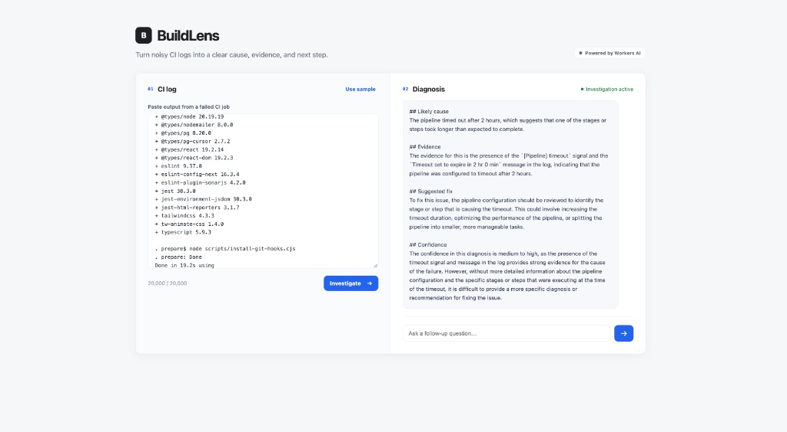
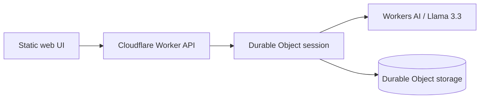

# BuildLens

BuildLens is a small, stateful AI assistant for investigating CI failures. Paste
a failed build log, receive an evidence-based diagnosis, and ask follow-up
questions without losing the investigation context.

[Cloudflare AI assignment details](./CLOUDFLARE_AI_ASSIGNMENT.md)



## Why this exists

CI failures often require engineers to scan noisy logs before they can take the
first useful action. BuildLens combines deterministic signal extraction with
an LLM so that its answer remains grounded in the supplied log.

## Cloudflare architecture




- **Workers AI** runs Llama 3.3 for diagnosis and follow-up reasoning.
- **Cloudflare Worker** validates requests and routes them to an investigation.
- **Durable Objects** provide one stateful conversation per investigation.
- **Static Assets** serve the responsive chat interface alongside the Worker.
- A small deterministic scanner supplies failure signals before LLM analysis.


## Run locally

Prerequisites: Node.js 20 or newer and a Cloudflare account.

```bash
npm install
npx wrangler login
npm run dev
```

Open the URL printed by Wrangler, select **Use sample**, and investigate it.
Workers AI calls made during local development use your Cloudflare account.

## Test

```bash
npm test
npm run typecheck
```


## Deploy

```bash
npm run deploy
```

Wrangler creates the Durable Object namespace and publishes the Worker and
static assets. No application secrets or environment variables are required.

## API


### Start an investigation

`POST /api/investigations`

```json
{ "log": "FAIL src/example.test.ts\nExpected 200, received 500" }
```


### Ask a follow-up

`POST /api/investigations/:sessionId/messages`

```json
{ "message": "What should I inspect first?" }
```


### Read session history

`GET /api/investigations/:sessionId/history`

The browser stores the investigation ID in `?session=<sessionId>`, so the URL
can be reopened or shared to resume the retained conversation.

Logs are limited to 20,000 characters and follow-ups to 2,000 characters. Log
contents are explicitly treated as untrusted data in the model prompt.

## Design trade-offs

- The MVP accepts pasted logs instead of requesting access to private GitHub
repositories. This keeps permissions and the demo simple.
- Session URLs act as bearer identifiers. Production use should add identity,
authorization, retention limits, and redaction before accepting private logs.
- The deterministic scanner is intentionally small. More failure fingerprints
and an evaluation dataset would be the next iteration.
- The UI renders model output as text, not HTML, to avoid script injection.


## AI-assisted development

AI-assisted coding helped pressure-test the idea, implement the selected
architecture, identify gaps, and verify the result. The developer chose the
product scope, Cloudflare services, input limits, state-retention policy,
response format, security boundaries, UI direction, and excluded features.

The curated development conversation is recorded in
[Prompt_history_export.md](./Prompt_history_export.md).